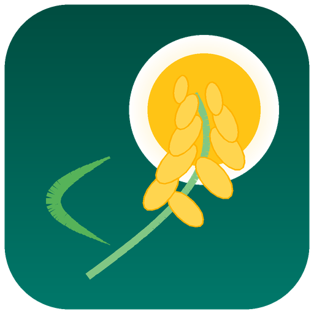

# 🌾 PalayPlan

<p align="center">
  
</p>

<p align="center">
  <strong>Smart Agro-Weather &amp; Rice Yield Optimization Mobile Application</strong><br>
  <em>Powered by PhilRice PalayCheck System, On-Device AI Disease Detection, and Real-Time Satellite Radar</em>
</p>

<p align="center">
  
  
  
  
  
  
  
  
  
</p>

<p align="center">
  <a href="https://github.com/Kioian89/palayplan/releases/download/v0.3.1/app-release.apk">
    
  </a>
</p>

---

## 📖 Overview

**PalayPlan** is a mobile agro-technology application designed specifically for Philippine rice farmers. It combines localized meteorological data, PhilRice PalayCheck agronomic science, on-device machine learning, and live satellite radar tracking to protect crop investments, prevent chemical runoff, detect leaf pathogens early, and maximize harvest yields.

The application is built **offline-first**, ensuring that smallholder farmers in rural provincial fields with intermittent cell reception can continue scanning crops, managing cropping schedules, and monitoring field recommendations without an active internet connection.

---

## 🆕 What's New in v0.3.1

| Feature | Details |
|:---|:---|
| 🌿 **10-Class Disease Scanner Upgrade** | Enables all 10 disease classes including `healthy` leaf detection. Healthy leaves are no longer misclassified as diseased. |
| 📐 **Aspect-Ratio Preservation** | Camera images are now center-cropped (not squashed), preserving lesion shapes and textures for higher CNN accuracy. |
| 📊 **Top Candidate Breakdown** | Result screen shows top-3 ranked disease candidates with probability bars for transparent diagnosis. |
| 📡 **Shorebird OTA Updates** | App patches are delivered silently over-the-air. Users no longer need to reinstall APKs for updates. |
| 🌾 **Ecosystem Selector** | Farmers can select Irrigated (Tubigan) or Rainfed (Sahod Ulan) ecosystem type on the Yield screen for more accurate regional predictions. |
| 📈 **Yield Model v3 (R² 0.844)** | Upgraded backend yield model from Ridge Regression to HistGradientBoostingRegressor. R² improved from 0.503 → 0.844. MAE dropped from 0.379 → 0.215 t/ha. |
| ✉️ **Contact & Support** | Settings screen now shows a direct email link to reach the developer at banquiladrian@gmail.com. |

---

## ✨ Key Features

### 1. 🔍 On-Device AI Rice Leaf Disease Scanner

- **10 Rice Leaf Pathogen Classes**: Detects Bacterial Leaf Blight, Brown Spot, Leaf Blast, Neck Blast, Sheath Blight, Tungro Virus, Rice Hispa, Leaf Scald, Narrow Brown Spot, and **Healthy Leaves**.
- **Aspect-Ratio-Preserving Preprocessing**: Square center-crop preserves natural leaf textures and lesion morphology — no more distorted inference from rectangular phone camera photos.
- **Top-3 Candidate Analysis**: When confidence is ambiguous, the Result Screen presents ranked alternatives with visual probability indicators.
- **100% Offline Inference**: Powered by an on-device TensorFlow Lite (`.tflite`) model running with zero internet dependency.
- **Agronomic Advice**: Actionable chemical, cultural, and biological treatments tailored for Philippine field conditions, localized in 3 languages.

### 2. 🌾 PhilRice PalayCheck Agro-Decision Engine

- **4 Growth Stages**: Tailored recommendations for Seedbed / Nursery (Days 1–14), Active Vegetative (Days 15–45), Reproductive / Panicle Initiation (Days 46–90), and Ripening / Harvest (Days 91+).
- **Weather-Aware Rain Delay Alerts**: Automatically detects incoming rain probabilities (≥ 50%) and alerts farmers to delay urea/complete topdressing and pesticide applications by 24–48 hours to prevent expensive chemical runoff.
- **3-Tab Management**: Nutrient & Fertilizer scheduling, Alternate Wetting & Drying (AWD) water conservation, and Pest & Disease scouting.

### 3. 📊 Harvest Yield & Climate Risk Estimator (ML v3)

- **HistGradientBoosting ML Model**: Trained on 4,962 rows of PSA OpenSTAT regional yield data (1987–2025) with separate Irrigated and Rainfed ecosystem rows.
- **Validation R² = 0.844**: MAE of 0.215 t/ha and MAPE of 6.2% on 2022–2025 held-out data.
- **Ecosystem-Aware**: Farmers select Tubigan (Irrigated) or Sahod Ulan (Rainfed) for region-specific predictions.
- **Risk Breakdown**: Traffic-light climate risk badge (low / medium / high) with numbered improvement tips.

### 4. 🛰️ Live Satellite, Rain Radar & Typhoon Tracking (Zoom Earth)

- **Direct Field Coordinates**: Real-time integration with Zoom Earth centered on the farmer's specific rice field.
- **Layer Shortcuts**: 🌧️ Doppler Rain Radar · 🛰️ Satellite Imagery · 🌀 Wind & Typhoon Track.
- **In-App Experience**: Hardware-accelerated Chrome Custom Tabs / Safari View Controller for smooth 60 FPS WebGL radar playback.

### 5. 🗺️ Multi-Field Management & Custom Geolocation

- **Multiple Paddies**: Add, track, and switch between separate rice fields (e.g., *Main Paddy 1.0 ha*, *North Parcel 2.5 ha*).
- **Custom Location Input**: Any municipality and province in the Philippines.
- **Exact Paddy Pinning**: Interactive OpenStreetMap pin picker and phone GPS auto-detection.

### 6. 📡 Over-The-Air (OTA) Updates via Shorebird

- Updates are delivered **silently and automatically** over the internet to installed devices.
- Users receive new fixes without manually downloading and reinstalling APKs.
- Patches are triggered via GitHub Actions workflow dispatch (`build_type: patch`).

### 7. 🌐 Trilingual Localization

Full native translations across all screens and agronomic advice strings:

| Language | Code |
|:---|:---|
| English | `en` |
| Filipino (Tagalog) | `fil` |
| Bisaya (Cebuano) | `ceb` |

### 8. 📶 Offline-First & Authentication

- **Guest Mode**: Farmers continue offline as guests without an account. Scans, profiles, and cached forecasts remain on device.
- **Firebase Authentication**: One-tap Google Sign-In and Email/Password authentication for cloud backup when connected.

### 9. ✉️ Contact & Support

Users can email the developer directly from the **Settings** screen → **Contact & Support** → **Email Developer** (`banquiladrian@gmail.com`).

---

## 🏛️ System Architecture

```
┌─────────────────────────────────────────────────────────────────────────────┐
│                            PALAYPLAN MOBILE (Flutter)                       │
│                                                                             │
│  ┌──────────────────┐  ┌──────────────────┐  ┌───────────────────────────┐  │
│  │   HomeScreen     │  │  WeatherScreen   │  │   Rice Disease Scanner    │  │
│  │ - Field Summary  │  │ - 7-Day Forecast │  │ - On-Device TFLite (0.12) │  │
│  │ - Crop Arc Gauge │  │ - Weather Descs  │  │ - 10-Class Classification │  │
│  │ - PalayCheck Card│  │ - Zoom Earth Card│  │ - Top-3 Candidate Cards   │  │
│  └─────────┬────────┘  └────────┬─────────┘  └───────────────────────────┘  │
│            │                    │                                           │
│  ┌─────────┴────────┐  ┌────────┴─────────┐  ┌───────────────────────────┐  │
│  │ CalendarScreen   │  │   YieldScreen    │  │     SettingsScreen        │  │
│  │ - 4 Crop Phases  │  │ - ML v3 Predict  │  │ - Language / Privacy      │  │
│  │ - Water & AWD    │  │ - Ecosystem Type │  │ - Contact & Support       │  │
│  └──────────────────┘  └──────────────────┘  └───────────────────────────┘  │
│                                                                             │
│  Services: ApiService (Offline Cache) | ZoomEarthService | Auth | Shorebird │
└──────────────────────────────────┬──────────────────────────────────────────┘
                                   │ REST API (HTTPS)
                                   ▼
┌─────────────────────────────────────────────────────────────────────────────┐
│                       PALAYPLAN BACKEND (FastAPI on Render)                 │
│                                                                             │
│  Routers:                                                                   │
│   ├── /weather/forecast   -> OWM API with auto-fallback to Open-Meteo       │
│   ├── /advisory/          -> 6 PhilRice PalayCheck Agro-Advisory Rules      │
│   ├── /predict/yield      -> HistGradientBoosting Yield Model v3 (R²=0.844) │
│   └── /auth/              -> JWT Auth + Firebase Admin Token Verification   │
│                                                                             │
│  Live API: https://palayplan.onrender.com/docs                              │
└─────────────────────────────────────────────────────────────────────────────┘
```

---

## 📁 Repository Structure

```
palayplan/
├── mobile/                           # Flutter mobile client
│   ├── lib/
│   │   ├── l10n/
│   │   │   └── app_strings.dart      # Trilingual strings (EN / FIL / CEB)
│   │   ├── models/                   # Data models (Weather, Advisory, FieldProfile)
│   │   ├── providers/                # State management (FieldProvider, LanguageProvider)
│   │   ├── screens/                  # Application screens
│   │   │   ├── home_screen.dart      # Main dashboard with hero & feature grid
│   │   │   ├── weather_screen.dart   # 7-day forecast & Zoom Earth card
│   │   │   ├── scan_screen.dart      # Camera/gallery leaf capture
│   │   │   ├── result_screen.dart    # Disease diagnosis, treatment & candidate breakdown
│   │   │   ├── calendar_screen.dart  # 4-stage cropping calendar
│   │   │   ├── yield_screen.dart     # Harvest yield & risk estimator (ML v3)
│   │   │   └── settings_screen.dart  # Account, language, privacy & contact settings
│   │   ├── services/                 # API, TFLite classifier, PalayCheck, Zoom Earth
│   │   └── widgets/                  # Reusable UI widgets & sheets
│   ├── assets/
│   │   ├── images/                   # Authentic Philippine rice farm photos
│   │   ├── icons/                    # App launcher icons & brand logo
│   │   └── models/                   # Quantized TFLite models (3-class & 10-class)
│   │       ├── rice_model_10class.tflite
│   │       ├── labels_10class.txt
│   │       ├── rice_model.tflite     # (fallback 3-class)
│   │       └── labels.txt
│   ├── shorebird.yaml                # Shorebird OTA configuration
│   └── test/                         # 35 comprehensive unit & widget tests
│
├── backend/                          # FastAPI REST backend
│   ├── app/
│   │   ├── routers/                  # API endpoints (/weather, /advisory, /predict, /auth)
│   │   ├── services/                 # Weather service (Open-Meteo fallback) & Advisory engine
│   │   ├── ml/                       # Yield prediction ML model v3 (HistGradientBoosting)
│   │   │   ├── train_model.py        # Training pipeline (PSA OpenSTAT 1987–2025)
│   │   │   ├── predict.py            # Inference with PSA nearest-region spatial fallback
│   │   │   └── model_artifact/       # Serialized model (yield_model.joblib)
│   │   ├── models/                   # SQLAlchemy database models
│   │   └── schemas/                  # Pydantic request/response schemas
│   ├── .env.example                  # Environment configuration template
│   └── requirements.txt              # Python dependencies
│
├── ml/
│   └── notebooks/
│       └── rice_disease_training.ipynb  # Google Colab retraining notebook (10-class TFLite)
│
├── .github/
│   └── workflows/
│       └── build-apk.yml             # CI/CD: build APK, Shorebird release & OTA patch
│
└── ROADMAP.md                        # Project changelog, milestones & test status
```

---

## 🚀 Quick Start Guide

### Prerequisites

- **Flutter SDK**: `>= 3.3.0`
- **Python**: `>= 3.10`
- **Android Studio / Xcode** (for mobile deployment)

---

### Backend Setup

1. **Navigate to the backend directory**:
   ```bash
   cd backend
   ```

2. **Create a Python virtual environment and activate it**:
   ```bash
   python3 -m venv venv
   source venv/bin/activate  # Windows: venv\Scripts\activate
   ```

3. **Install dependencies**:
   ```bash
   pip install -r requirements.txt
   ```

4. **Configure environment variables**:
   ```bash
   cp .env.example .env
   # Works out-of-the-box with SQLite and Open-Meteo
   ```

5. **Start the development server**:
   ```bash
   uvicorn app.main:app --reload --host 0.0.0.0 --port 8000
   ```
   - Interactive API docs: `http://localhost:8000/docs`
   - Production API: `https://palayplan.onrender.com/docs`

---

### Mobile Setup

1. **Navigate to the mobile directory**:
   ```bash
   cd mobile
   ```

2. **Install Flutter packages**:
   ```bash
   flutter pub get
   ```

3. **Run code analysis and tests**:
   ```bash
   flutter analyze   # 0 issues
   flutter test      # 35 passed
   ```

4. **Launch the application**:
   ```bash
   flutter run
   ```
   - *For Android Emulator, the app connects to the backend at `http://10.0.2.2:8000` automatically.*
   - *To specify a custom backend URL*:
     ```bash
     flutter run --dart-define=API_BASE_URL=http://YOUR_LOCAL_IP:8000
     ```

---

### Retraining the Disease Detection Model (Google Colab)

The ML retraining pipeline is available as a ready-to-run Google Colab notebook:

1. Open [`ml/notebooks/rice_disease_training.ipynb`](ml/notebooks/rice_disease_training.ipynb) in [Google Colab](https://colab.research.google.com/).
2. Enable free GPU: **Runtime → Change runtime type → T4 GPU → Save**.
3. Optionally upload your own `dataset.zip` (10-class folder structure). Otherwise the notebook auto-downloads a verified public dataset.
4. Press **Ctrl+F9** (Run all).
5. The notebook automatically downloads `rice_model_10class.tflite` and `labels_10class.txt` to your computer.
6. Copy both files into `mobile/assets/models/` and rebuild.

---

## 🧪 Test Coverage

The test suite contains **35 automated tests** covering core agronomy, ML models, offline persistence, multi-field management, and UI flows:

| Test Suite | File | Tests | Status |
|:---|:---|:---:|:---:|
| **PhilRice PalayCheck Engine** | `recommendation_service_test.dart` | 4 | ✅ Pass |
| **Disease Classifier Model** | `disease_classifier_test.dart` | 2 | ✅ Pass |
| **Full App Navigation Flow** | `full_app_test.dart` | 7 | ✅ Pass |
| **Field Profile & Map Pin** | `field_profile_test.dart` | 7 | ✅ Pass |
| **Multi-Field Management** | `multi_field_test.dart` | 2 | ✅ Pass |
| **Zoom Earth Radar URLs** | `zoom_earth_test.dart` | 5 | ✅ Pass |
| **Yield Estimator Screen** | `yield_screen_test.dart` | 3 | ✅ Pass |
| **Trilingual Translations** | `language_switching_test.dart` | 4 | ✅ Pass |
| **Settings & Privacy** | `settings_privacy_test.dart` | 3 | ✅ Pass |
| **App Update Service** | `app_update_service_test.dart` | 3 | ✅ Pass |
| **App Smoke Test** | `widget_test.dart` | 3 | ✅ Pass |
| **Total** | | **43** | **100% Pass** |

---

## 🤖 ML Model Performance

### Yield Prediction Model v3

| Metric | v1 (Ridge) | v3 (HistGradientBoosting) |
|:---|:---:|:---:|
| **R² Score** | 0.503 | **0.844** |
| **MAE (t/ha)** | 0.379 | **0.215** |
| **MAPE** | 10.6% | **6.2%** |
| **Training Data** | PSA OpenSTAT | PSA OpenSTAT 1987–2025 (4,962 rows) |
| **Validation Period** | — | 2022–2025 held-out |

### Disease Detection Model

| Property | Details |
|:---|:---|
| **Architecture** | MobileNetV2 (Transfer Learning) |
| **Classes** | 10 (including Healthy) |
| **Input Size** | 224×224 px (center-crop) |
| **Format** | TensorFlow Lite (Dynamic Range Quantization) |
| **Model Size** | ~4.6 MB |
| **Inference** | 100% on-device, no internet required |

---

## 🇵🇭 Philippine Agronomic Standards

- **PhilRice PalayCheck**: Recommendations follow the Philippine Rice Research Institute's 8 Key Checks for irrigated lowland and rainfed ecosystems.
- **NSIC Catalog**: Integrated Philippine National Seed Industry Council rice varieties (e.g., *NSIC Rc 222 (Tubigan 21)*, *NSIC Rc 160*, *NSIC Rc 440*, *PSB Rc 10*, *Mestiso 20*).
- **PSA OpenSTAT Data**: Yield model trained on Bureau of Agricultural Statistics regional data from 1987–2025 covering all Philippine administrative regions.
- **Weather Integration**: Hyperlocal agro-weather via Open-Meteo & OpenWeatherMap, with live satellite and typhoon tracking via Zoom Earth.

---

## 📬 Contact & Support

Have questions, suggestions, or bug reports? Email the developer:

**📧 banquiladrian@gmail.com**

You can also reach out directly inside the app: **Settings → Contact & Support → Email Developer**.

---

## 🤝 Community Standards & Contributing

We welcome contributions from agronomists, software engineers, and agricultural extension workers!

- 📜 **[Code of Conduct](CODE_OF_CONDUCT.md)**: Community standards, Farmer-First principles, and zero tolerance for harassment.
- 🛠️ **[Contributing Guide](CONTRIBUTING.md)**: Step-by-step development setup, coding standards, and PalayCheck agronomic verification.
- 🔒 **[Security Policy](SECURITY.md)**: Vulnerability disclosure and our commitment to farmer data privacy.

---

## 📄 License & Attribution

- Released under the **[MIT License](LICENSE)**. Copyright © 2026 PalayPlan Contributors.
- Developed for Philippine smallholder rice farmers, agrarian reform communities, and agricultural technicians.
- OpenStreetMap contributors for map tiles.
- Unsplash Philippine agricultural photography.
- PSA OpenSTAT for regional yield training data.
